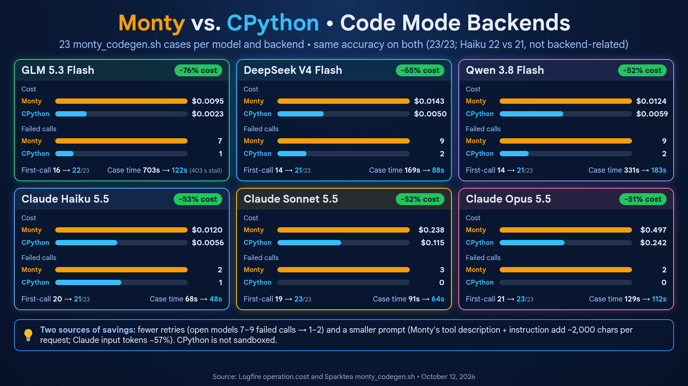

# Monty vs. CPython: Code Mode backends

On October 12, 2026, six models ran the 23 `monty_codegen.sh` tasks twice:
once with the Monty sandbox (the default) and once with local CPython
(`-code-backend cpython`). Each model's two runs were back to back, with no
other run overlapping. For how the two backends are built, see
[CODE-MODE.md](../CODE-MODE.md).

## Summary

CPython didn't change accuracy, and every model needed fewer calls, fewer
tokens and less money with it.

| Model | Cost, Monty → CPython | Change | Failed calls | First-call completions |
|---|---|---:|---|---|
| GLM 5.3 Flash | $0.0095 → $0.0023 | −76% | 7 → 1 | 16 → 22 |
| DeepSeek V4 Flash | $0.0143 → $0.0050 | −65% | 9 → 2 | 14 → 21 |
| Claude Haiku 5.5 | $0.0120 → $0.0056 | −53% | 2 → 1 | 20 → 21 |
| Qwen 3.8 Flash | $0.0124 → $0.0059 | −52% | 9 → 2 | 14 → 21 |
| Claude Sonnet 5.5 | $0.2378 → $0.1153 | −52% | 3 → 0 | 19 → 23 |
| Claude Opus 5.5 | $0.4975 → $0.2417 | −51% | 2 → 0 | 21 → 23 |

- **The saving has two sources:**
  - **Fewer retries.** The models that struggled most with Monty's limits
    (GLM, DeepSeek Flash and Qwen) went from 7–9 failed calls to 1–2.
  - **A smaller prompt.** Monty's tool description and instruction add about
    2,000 characters to every request. With the Claude models, which already
    work within Monty's limits fairly well, this is most of the saving:
    input tokens fell about 57% while failures barely changed.
- **Accuracy:** every model scored 23/23 on both backends except Haiku. Its
  misses had nothing to do with the backend (see below).
- **Time:** total case time fell 13–83%. The interpreter itself was never the
  bottleneck; nearly all of a turn is spent waiting for the model.

## Method

- **Script:** `monty_codegen.sh -m <model> -b <backend>`, using the same 23
  tasks as the earlier reports. Most tasks tempt the model toward Python that
  Monty doesn't support.
- **Code:** sparktea on `pydantic-ai-go-v0.5.0`, from `a3479a8` (the CPython
  backend with tracing) through `1a66617` (the stall watchdog). None of those
  changes touch the Monty path.
- **Concurrency:** GLM and the Claude models ran four cases at a time
  (`-j 4`). Qwen and DeepSeek ran one at a time (`-j 1`), after an earlier
  four-at-a-time attempt was disrupted by OpenRouter stalls (see "Caveats").
- **Data sources:**
  - **Logfire** (project `tomfoolery`, service `sparktea`): cost
    (`operation.cost` summed over `chat` spans), tokens, model requests, and
    case time (the `sparktea turn` span duration summed over the 23 cases).
    Turns are grouped by `sparktea.code_backend`.
  - **The run logs:** calls, failures, first-call completions and code size.

| Model | Provider | Monty run (UTC) | CPython run (UTC) |
|---|---|---|---|
| GLM 5.3 Flash | OpenRouter | 14:38–14:45 | 14:46–14:47 |
| Claude Haiku 5.5 | Anthropic | 14:52 | 14:52–14:53 |
| Claude Sonnet 5.5 | Anthropic | 14:53 | 14:53–14:54 |
| Claude Opus 5.5 | Anthropic | 14:54 | 14:54–14:55 |
| Qwen 3.8 Flash | OpenRouter | 15:11–15:17 | 15:17–15:20 |
| DeepSeek V4 Flash | OpenRouter | 15:52–15:55 | 15:55–15:57 |

## Full results

| Model | Backend | Scored | First call | `run_code` calls (failed) | Final code (chars) | Requests | Input tokens | Output tokens | Cost | Case time |
|---|---|---:|---:|---:|---:|---:|---:|---:|---:|---:|
| GLM 5.3 Flash | Monty | 23/23 | 16 | 31 (7) | 10,974 | 53 | 64,700 | 19,191 | $0.0095 | 702.7 s* |
| | CPython | 23/23 | 22 | 24 (1) | 4,846 | 47 | 21,327 | 5,461 | $0.0023 | 122.0 s |
| DeepSeek V4 Flash | Monty | 23/23 | 14 | 35 (9) | 8,265 | 58 | 86,926 | 16,814 | $0.0143 | 168.6 s |
| | CPython | 23/23 | 21 | 25 (2) | 4,423 | 48 | 31,360 | 4,923 | $0.0050 | 88.3 s |
| Qwen 3.8 Flash | Monty | 23/23 | 14 | 39 (9) | 12,664 | 61 | 82,138 | 16,140 | $0.0124 | 331.2 s |
| | CPython | 23/23 | 21 | 27 (2) | 5,388 | 50 | 34,442 | 8,230 | $0.0059 | 183.0 s |
| Claude Haiku 5.5 | Monty | 22/23 | 20 | 25 (2) | 6,307 | 48 | 75,878 | 8,804 | $0.0120 | 67.6 s |
| | CPython | 21/23 | 21 | 24 (1) | 3,622 | 46 | 33,100 | 4,560 | $0.0056 | 47.5 s |
| Claude Sonnet 5.5 | Monty | 23/23 | 19 | 27 (3) | 5,662 | 50 | 78,378 | 8,108 | $0.2378 | 91.2 s |
| | CPython | 23/23 | 23 | 23 (0) | 3,330 | 46 | 33,717 | 4,788 | $0.1153 | 64.4 s |
| Claude Opus 5.5 | Monty | 23/23 | 21 | 25 (2) | 5,420 | 48 | 76,593 | 9,555 | $0.4975 | 128.6 s |
| | CPython | 23/23 | 23 | 23 (0) | 3,067 | 46 | 33,414 | 5,402 | $0.2417 | 111.6 s |

\* One GLM request on Monty (`dataclass`) took 403 s to stream 1,820 tokens,
which was provider latency. Without it, GLM's Monty case time is about 300 s.

## Why calls failed

Monty, 32 failed calls across the six runs:

| Error | Count | Typical cause |
|---|---:|---|
| `NotImplementedError` | 18 | class inheritance, generators, `match`, custom exceptions, `enum` |
| `ImportError` | 4 | `dataclasses.field`, `functools.lru_cache` |
| `LookupError` | 3 | the `latin-1` codec |
| `TypeError` | 3 | `@property`, a custom exception class, `bytes()` of a list |
| `AttributeError` | 2 | `int.to_bytes`, `sys.modules` |
| `RecursionError` | 1 | the 100-frame recursion limit |
| `ValueError` | 1 | GLM's own parsing bug (`int('left')`) |

29 of the 32 hit limits the Monty tool description already lists; the models
tried those features anyway. Two hit gaps the description doesn't mention:
`bytes()` of a list of integers and `sys.modules`. One was a bug in the
model's own code.

CPython, 6 failed calls:

| Error | Count | Cause |
|---|---:|---|
| `SyntaxError` | 2 | the model's own typos (GLM: a walrus inside a comprehension; DeepSeek: unbalanced brackets) |
| `ModuleNotFoundError` | 1 | DeepSeek imported `sympy`, which isn't installed |
| `TimeoutError` | 1 | Qwen hit the 5-second limit |
| `AssertionError` | 1 | Qwen's own self-check |
| decode error | 1 | Haiku sent a parallel call with empty arguments (see below) |

## Interpreter speed

From all of the day's interpreter spans:

| | `monty.run` (273 calls) | `python.run` (238 calls) |
|---|---:|---:|
| Median | 0.4 ms | 51.4 ms |
| 90th percentile | 1.5 ms | 69.5 ms |
| Median script time | — | 0.2 ms |
| Longest | 1,123 ms | 5,004 ms (a timeout) |
| Total across all calls | 8.2 s | 19.3 s |

- **Small scripts:** Monty is more than 100 times faster per call, because
  CPython starts a new process each time (about 50 ms).
- **Heavy compute:** CPython is faster. GLM's naive recursive `fib(32)` took
  812 ms on Monty and 272 ms on CPython.
- **Either way:** the interpreter is a few seconds per run at most, against
  minutes of model time.

## Haiku's misses

- **`formatting`:** failed on both backends because Haiku wrote `1234567` in
  its final answer instead of `1,234,567`. The same slip appears in the
  October 10 Claude report.
- **`primes` on CPython:** Haiku's first call returned the right answer
  (15), but it also sent a parallel `run_code` call with empty arguments.
  That call failed to decode. pydantic-ai-go then sent it back to Anthropic
  without an `input` field, and Anthropic rejected the request with HTTP 400
  (`req_011CfxXqrBcjqyGC4Xj7EDMt`). This is a pydantic-ai-go issue, not the
  backend.

## Caveats

- **What's being compared:** the two backends differ in prompt as well as
  interpreter. Monty's tool description is about 2,200 characters, with a
  320-character system instruction; CPython's is about 570 characters, with
  no instruction. These results measure the whole Code Mode setup, not the
  interpreter alone.
- **CPython is not a sandbox:** scripts run as the local user, with network
  access.
- **Single runs:** there's one run per model and backend, and repeats vary.
  - Qwen's earlier four-at-a-time runs cost $0.0225 (Monty) and $0.0165
    (CPython). Most of that came from one case where Qwen distrusted
    `hashlib`'s output and re-implemented SHA-256 by hand to check it.
  - DeepSeek's repeat runs agreed to within a call or two.
- **Provider stalls:** the first attempt at the DeepSeek Monty run was
  spoiled by three OpenRouter streams that stopped mid-response and hung for
  up to about 12 minutes before the connection reset. That led to sparktea's
  stall watchdog (`1a66617`). The DeepSeek runs here are the clean rerun.
- **No prompt caching:** Anthropic prompt caching wasn't active in these
  runs. The October 10 Claude report had about 40k cached tokens per model,
  so its costs are lower ($0.40 against $0.50 for Opus on Monty) and not
  directly comparable.
- **Backend labels in Logfire:** the GLM and Claude runs recorded the CPython
  backend as `sparktea.code_backend = "python"`; the value became `cpython`
  at `a9bdc86`, before the Qwen and DeepSeek runs. Query both.
