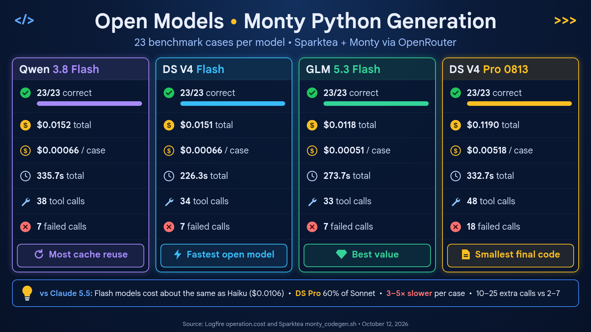
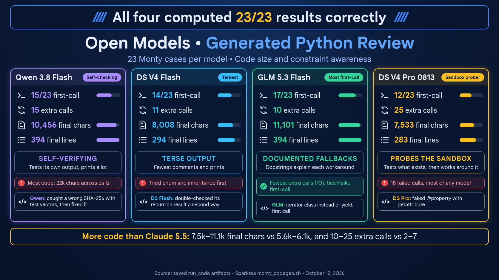

# OpenRouter models on Monty: `monty_codegen.sh` runs

This report has two parts:

- **October 12, 2026:** a retest of four OpenRouter models (Qwen 3.8 Flash,
  DeepSeek V4 Flash, GLM 5.3 Flash and DeepSeek V4 Pro 0813), compared with
  the Claude 5.5 run in
  [claude-5-5-monty-analysis.md](claude-5-5-monty-analysis.md).
- **October 10, 2026:** the runs made during the pydantic-ai-go v0.5.0
  upgrade (PR #12), before and after the switch to `StartRun`.

## October 12 retest: OpenRouter vs. Claude 5.5

The generated-code graphic is based on the final `run_code` submissions:

- comments, `print` calls and `try` blocks were counted per model;
- each first attempt was checked for features Monty rejects;
- individual retry sequences were read by hand.

Its bars use a fixed scale: 12,000 chars and 400 lines.

The OpenRouter models ran with the same sparktea code as the Claude 5.5 run
of October 10 (after `7b1ab27`, with `StartRun` and the Monty instruction).
The only later changes are docs. Each model ran once, with `-j 4`. The four
models ran at the same time, so up to 16 cases were in flight.

Cost, tokens and timing come from Logfire (project `tomfoolery`, service
`sparktea`):

- cost is `operation.cost` summed over the `chat` spans;
- time is the `sparktea turn` span duration summed over the 23 cases.

Re-querying the Claude run the same way gives exactly the figures in the
Claude report. Calls, errors and code size come from the run logs, with code
counted from the `[tool call] run_code` lines on stderr.

### Results

| Metric | Haiku 5.5 | Sonnet 5.5 | Opus 5.5 | Qwen 3.8 Flash | DS V4 Flash | GLM 5.3 Flash | DS V4 Pro 0813 |
| --- | ---: | ---: | ---: | ---: | ---: | ---: | ---: |
| Scored results | 22/23 | 23/23 | 23/23 | 23/23 | 23/23 | 23/23 | 23/23 |
| First-call completions | 17 | 18 | 21 | 15 | 14 | 17 | 12 |
| Total `run_code` calls | 30 | 28 | 25 | 38 | 34 | 33 | 48 |
| Extra calls | 7 | 5 | 2 | 15 | 11 | 10 | 25 |
| Tool-reported errors | 6 | 3 | 2 | 7 | 7 | 7 | 18 |
| Code across all calls (chars) | 8,053 | 7,207 | 7,435 | 21,959 | 14,100 | 15,096 | 18,947 |
| Final code (chars) | 6,141 | 6,006 | 5,638 | 10,456 | 8,008 | 11,101 | 7,533 |
| Benchmark cost | $0.0106 | $0.1905 | $0.3996 | $0.0152 | $0.0151 | $0.0118 | $0.1190 |
| Average cost per case | $0.00046 | $0.00828 | $0.01737 | $0.00066 | $0.00066 | $0.00051 | $0.00518 |
| Total case time | 68.3 s | 83.4 s | 129.0 s | 335.7 s | 226.3 s | 273.7 s | 332.7 s |
| Average time per case | 2.97 s | 3.63 s | 5.61 s | 14.60 s | 9.84 s | 11.90 s | 14.47 s |
| Average time to first chunk | 0.74 s | 1.15 s | 1.96 s | 1.75 s | 0.90 s | 0.95 s | 1.22 s |
| Model requests | 53 | 51 | 48 | 61 | 57 | 56 | 71 |
| Input tokens | 86,145 | 80,284 | 76,467 | 103,149 | 85,454 | 73,029 | 126,667 |
| Output tokens | 10,068 | 8,412 | 9,728 | 19,840 | 16,706 | 21,324 | 24,407 |
| of which reasoning | 0 | 0 | 0 | 6,199 | 8,217 | 13,637 | 13,685 |
| Cache-read tokens | 45,112 | 41,000 | 36,909 | 71,680 | 15,616 | 43,182 | 57,314 |

### Observations

- **Scores:** all seven models completed every case. Haiku's single miss was
  a formatting slip in its final answer.
- **Cost:** the three open models cost about the same as Haiku per run
  ($0.012–0.015 vs. $0.011). DeepSeek V4 Pro cost about 60% of Sonnet and
  30% of Opus.
- **Retries:** the Claude models needed fewer retries. Opus made 2 extra
  calls and Sonnet 5; the open models made 10–25. GLM matched Haiku on
  first-call completions (17). DeepSeek V4 Pro needed the most retries and
  hit the most tool errors.
- **Code size:** the open models wrote about 1.3–1.9 times as much final code
  as the Claude models, and about 2–3 times as much across all calls.
  Qwen's `sha256` alone took five calls to write and check a SHA-256
  implementation.
- **Time:** the open models were 3–5 times slower per case. Part of that is
  output tokens spent on reasoning. They also ran up to 16 cases at once,
  more than the Claude run did, so the times aren't a clean comparison.
- **Rate limits:** no 429s this time. Qwen ran its whole suite without
  retries from the script.

### Per case

Each cell is `run_code calls/failed calls`, then the Monty error types.

| Case | Qwen 3.8 Flash | DS V4 Flash | GLM 5.3 Flash | DS V4 Pro 0813 |
|---|---|---|---|---|
| asyncio | 1/0 | 1/0 | 1/0 | 1/0 |
| basic_arith | 1/0 | 1/0 | 1/0 | 1/0 |
| counter | 1/0 | 1/0 | 1/0 | 1/0 |
| custom_exc | 2/1 TypeError | 1/0 | 2/1 NotImplementedError | 3/2 NotImplementedError×2 |
| dataclass | 6/2 ImportError×2 | 2/1 ImportError | 3/2 ImportError×2 | 6/2 AttributeError, ImportError |
| datetime | 1/0 | 1/0 | 1/0 | 1/0 |
| deep_recursion | 1/0 | 2/0 | 1/0 | 2/1 RecursionError |
| enum | 1/0 | 2/1 NotImplementedError | 3/1 NotImplementedError | 2/1 TypeError |
| formatting | 1/0 | 1/0 | 1/0 | 1/0 |
| generator | 2/1 NotImplementedError | 2/1 TimeoutError | 1/0 | 2/1 NotImplementedError |
| inheritance | 1/0 | 2/1 NotImplementedError | 2/1 NotImplementedError | 2/1 NotImplementedError |
| itertools | 1/0 | 1/0 | 1/0 | 1/0 |
| json | 1/0 | 1/0 | 1/0 | 1/0 |
| latin1 | 2/0 | 2/1 LookupError | 1/0 | 3/1 LookupError |
| lru_cache | 2/1 ImportError | 1/0 | 1/0 | 1/0 |
| match | 1/0 | 1/0 | 2/1 NotImplementedError | 2/1 NotImplementedError |
| naive_fib | 1/0 | 1/0 | 1/0 | 1/0 |
| primes | 1/0 | 1/0 | 1/0 | 1/0 |
| property | 2/1 TypeError | 2/1 TypeError | 1/0 | 5/3 AttributeError×2, TypeError |
| regex | 2/0 | 4/0 | 4/1 NameError | 6/3 AttributeError×2, LookupError |
| sha256 | 5/1 AttributeError | 2/1 LookupError | 1/0 | 3/2 LookupError, ModuleNotFoundError |
| sorting | 1/0 | 1/0 | 1/0 | 1/0 |
| statistics | 1/0 | 1/0 | 1/0 | 1/0 |

Every model wrote around the documented limits on `statistics`, `json`,
`asyncio`, `itertools`, `counter` and `formatting` on the first call. Most
of the remaining errors come from features the `run_code` description
already lists as missing:

- `dataclasses` helpers (`ImportError`);
- inheritance, `match` and generators (`NotImplementedError`);
- the `latin-1` codec (`LookupError`).

The models tried them anyway, then fell back.

These are single runs. Repeat runs of the same model on October 10 varied
by a case or two.

## October 10: runs during the v0.5.0 upgrade

These runs were made during the pydantic-ai-go v0.5.0 upgrade (PR #12).
Four OpenRouter models were tested at three stages of the branch. The run
logs were in `/tmp/monty-codegen.*`. Each log directory was matched to its
model using Logfire, because the per-case `.result` files don't record the
model.

### Stages

| Stage | Commit | Change |
|---|---|---|
| A | `a51c3de` / `8779fa5` | pydantic-ai-go v0.5.0, gomonty v0.0.18, expanded `run_code` description; turns use `RunStream` |
| B | `c679dbf` | adds the Monty instruction to the system prompt when code mode is on |
| C | `4f58411` | turns use `StartRun` instead of `RunStream` |

### Summary

Cases passed out of 23:

| Model | A | B | C |
|---|---|---|---|
| qwen/qwen3.8-flash | 22, 23 | 20 (3 errors) | 23 (over three runs) |
| ~deepseek/deepseek-v4-flash-latest | 14, 15 | 14 | 23 |
| z-ai/glm-5.3-flash | 15 | not run | 23 |
| deepseek/deepseek-v4-pro-0813 | 9 | 11 | 23 |

- Stage A had two runs each for Qwen and DeepSeek Flash.
- **Stage B errors:** Qwen's three errors were provider errors, not wrong
  answers. Logfire shows six failed `chat` spans in that window.
- **Stage C, Qwen:** the first run returned an HTTP 429 on every case;
  OpenRouter reported Alibaba as rate-limited upstream. The 23 passes came
  from three later runs, one case at a time (6 + 14 + 3). See issue #11.

The Monty instruction (B) didn't help. Switching to `StartRun` (C) brought
every model to 23/23. Under `RunStream`, a response with text before a tool
call ended the turn with that text as the answer, and the tool result never
went back to the model. In A and B, almost every non-Qwen `WRONG` was that
case, not bad Python. For the cause and how it was found, see the
`RunStream` section of [ISSUES.md](../ISSUES.md).

### Per case

Each cell is `status(run_code calls/failed calls)`. Stage A uses the second
run where there were two; stage C Qwen is the passing run from the
three.

| Case | Qwen A | DS Flash A | GLM A | DS Pro A | Qwen C | DS Flash C | GLM C | DS Pro C |
|---|---|---|---|---|---|---|---|---|
| basic_arith | PASS(1/0) | PASS(1/0) | PASS(1/0) | PASS(1/0) | PASS(1/0) | PASS(1/0) | PASS(1/0) | PASS(1/0) |
| statistics | PASS(1/0) | WRONG(1/1) | PASS(1/0) | PASS(1/0) | PASS(1/0) | PASS(1/0) | PASS(1/0) | PASS(1/0) |
| primes | PASS(1/0) | PASS(1/0) | PASS(2/1) | WRONG(1/0) | PASS(1/0) | PASS(1/0) | PASS(1/0) | PASS(1/0) |
| inheritance | PASS(2/1) | WRONG(1/0) | PASS(2/1) | WRONG(1/1) | PASS(1/0) | PASS(2/1) | PASS(2/1) | PASS(2/1) |
| property | PASS(4/2) | WRONG(4/2) | WRONG(2/2) | WRONG(1/1) | PASS(1/0) | PASS(1/0) | PASS(1/0) | PASS(14/6) |
| generator | PASS(3/2) | WRONG(2/1) | WRONG(1/0) | WRONG(1/1) | PASS(2/1) | PASS(2/1) | PASS(2/1) | PASS(2/1) |
| match | PASS(2/1) | PASS(2/1) | WRONG(2/1) | WRONG(2/1) | PASS(1/0) | PASS(1/0) | PASS(3/2) | PASS(1/0) |
| custom_exc | PASS(4/2) | PASS(2/1) | PASS(3/2) | WRONG(1/1) | PASS(1/0) | PASS(2/1) | PASS(2/1) | PASS(2/1) |
| enum | PASS(3/1) | WRONG(2/1) | WRONG(2/1) | WRONG(1/1) | PASS(1/0) | PASS(1/0) | PASS(1/0) | PASS(1/0) |
| dataclass | PASS(5/4) | PASS(6/3) | PASS(1/0) | WRONG(1/1) | PASS(6/3) | PASS(2/1) | PASS(5/3) | PASS(6/2) |
| counter | PASS(1/0) | PASS(1/0) | PASS(1/0) | PASS(1/0) | PASS(1/0) | PASS(1/0) | PASS(1/0) | PASS(1/0) |
| regex | PASS(3/0) | PASS(4/0) | WRONG(2/1) | WRONG(1/1) | PASS(1/0) | PASS(1/0) | PASS(1/0) | PASS(2/1) |
| json | PASS(1/0) | WRONG(1/0) | PASS(1/0) | PASS(1/0) | PASS(1/0) | PASS(1/0) | PASS(1/0) | PASS(1/0) |
| datetime | PASS(1/0) | PASS(1/0) | PASS(1/0) | PASS(1/0) | PASS(1/0) | PASS(2/0) | PASS(1/0) | PASS(1/0) |
| sha256 | PASS(12/3) | PASS(2/1) | ERROR(0/0) | WRONG(1/1) | PASS(4/1) | PASS(9/1) | PASS(1/0) | PASS(2/1) |
| asyncio | PASS(1/0) | WRONG(1/0) | PASS(1/0) | WRONG(1/0) | PASS(2/1) | PASS(1/0) | PASS(1/0) | PASS(1/0) |
| itertools | PASS(1/0) | WRONG(1/0) | PASS(1/0) | PASS(1/0) | PASS(1/0) | PASS(1/0) | PASS(1/0) | PASS(1/0) |
| lru_cache | PASS(2/0) | PASS(2/1) | PASS(1/0) | PASS(1/0) | PASS(1/0) | PASS(1/0) | PASS(1/0) | PASS(1/0) |
| latin1 | PASS(1/0) | PASS(1/0) | WRONG(3/1) | WRONG(1/1) | PASS(2/1) | PASS(1/0) | PASS(2/1) | PASS(1/0) |
| sorting | PASS(1/0) | PASS(1/0) | PASS(1/0) | PASS(1/0) | PASS(1/0) | PASS(2/1) | PASS(1/0) | PASS(1/0) |
| formatting | PASS(1/0) | PASS(1/0) | WRONG(1/0) | PASS(1/0) | PASS(1/0) | PASS(1/0) | PASS(1/0) | PASS(1/0) |
| deep_recursion | PASS(1/0) | PASS(1/0) | PASS(1/0) | WRONG(1/0) | PASS(1/0) | PASS(1/0) | PASS(1/0) | PASS(4/3) |
| naive_fib | PASS(1/0) | PASS(1/0) | PASS(1/0) | WRONG(1/0) | PASS(1/0) | PASS(1/0) | PASS(1/0) | PASS(1/0) |

GLM's stage A `sha256` ERROR came after 821 seconds. The OpenRouter
stream reset (`connection reset by peer`) while the model was writing a
pure-Python SHA-256.

### run_code totals and cost

| Model, stage C | run_code calls | failed | cost (USD) |
|---|---|---|---|
| ~deepseek/deepseek-v4-flash-latest | 37 | 6 | 0.017 |
| z-ai/glm-5.3-flash | 33 | 9 | 0.015 |
| deepseek/deepseek-v4-pro-0813 | 49 | 16 | 0.189 |
| qwen/qwen3.8-flash | 47 | 12 | 0.015 (includes the 429 run) |

In stage A, single runs of DeepSeek Pro and GLM cost $0.050 and $0.009. Both
cost more in stage C because their turns now go on past the first text part.

Failed `run_code` calls by Monty error type, summed over the runs in each
stage:

| Error | A (6 runs) | C (4 models) |
|---|---|---|
| NotImplementedError | 29 | 15 |
| LookupError | 13 | 6 |
| TypeError | 10 | 3 |
| ImportError / ModuleNotFoundError | 11 | 5 |
| AttributeError | 8 | 7 |
| SyntaxError | 3 | 2 |
| ValueError | 0 | 3 |
| RecursionError | 0 | 2 |
| TimeoutError / RuntimeError | 2 | 0 |

`NotImplementedError` is mostly class inheritance, `@property`, `match`, and
`asyncio.sleep`. `LookupError` is mostly the `latin-1` codec.

### Other live checks

- `test_sparktea.sh` against Qwen 3.8 Flash on OpenRouter: 9 passed, 1
  skipped.
- **Streaming after the `StartRun` switch:** text still streams in chunks.
  A DeepSeek reply of 206 bytes arrived in 24 stdout writes.
- Logfire shows the Monty instruction in `gen_ai.system_instructions` when
  `-code` is set.

### Limits

These are single runs per model and stage, so the per-case results are
noisy. In stage A, the two Qwen runs scored 22 and 23 and the two DeepSeek
Flash runs 14 and 15. Qwen's stage C result is combined from three partial
runs.
